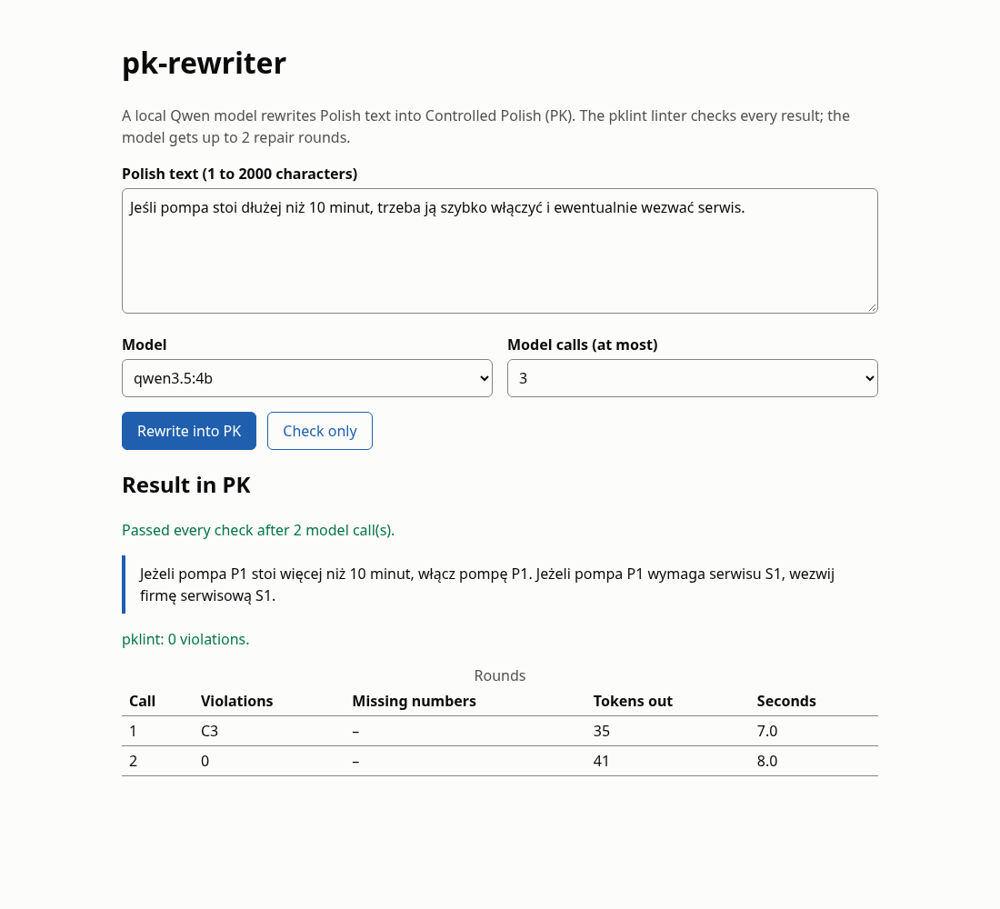
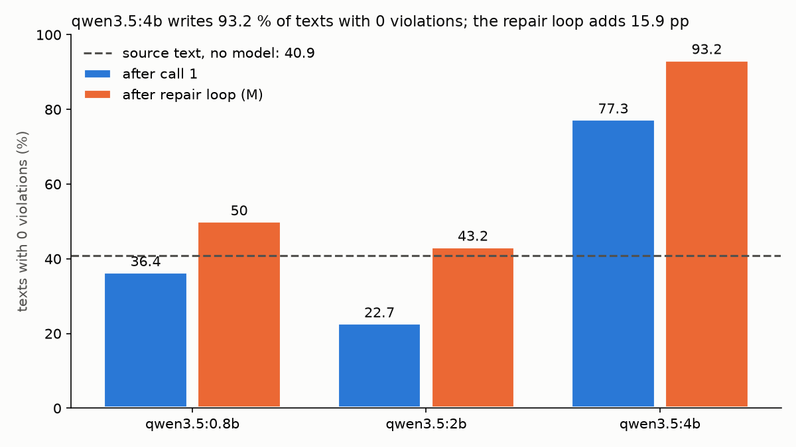

# pk-rewriter

A local Qwen3.5 model rewrites Polish text into Controlled Polish (PK, *Polszczyzna Kontrolowana*). The `pklint` linter checks every result and sends each violation back to the model. Everything runs on a laptop CPU through [Ollama](https://ollama.com). Polish version: [README.pl.md](README.pl.md).

## Goal

PK is plain Polish plus a set of rules; each rule removes one source of sentences with more than 1 meaning ([standard and paper](https://github.com/maciejszulia/polszczyzna-kontrolowana)). Rewriting a text into PK by hand is slow. This project measures how well a small open model does it on commodity hardware, with an automatic and objective check instead of a human impression:

- **generate**: the model rewrites the text, guided by a 586-token Polish system prompt that summarises the PK 0.1 standard;
- **check**: `pklint` runs 21 regular-expression checks of PK rules; a number check makes sure no number of the source text gets lost;
- **repair**: every violation goes back to the model with the rule it breaks; the model gets at most 3 calls per text.

## Screenshot



## Results

Measured on 2026-11-15 on the laptop described in [Machine](#machine); source: `eval/results/summary.json`, written by `python eval/run_eval.py --summary`.

| Model | Texts | 0 violations after call 1 (%) | 0 violations after loop, M (%) | Mean rounds | chrF after call 1 | chrF after loop | Seconds per text | Tokens per second |
|---|---|---|---|---|---|---|---|---|
| source text (nat), no model | 44 | 40.9 | – | – | 58.51 | – | – | – |
| qwen3.5:0.8b | 44 | 36.4 | 50.0 | 2.16 | 29.86 | 30.64 | 27.66 | 7.3 |
| qwen3.5:2b | 44 | 22.7 | 43.2 | 2.36 | 37.6 | 38.87 | 46.16 | 7.6 |
| qwen3.5:4b | 44 | 77.3 | 93.2 | 1.34 | 41.55 | 42.24 | 44.4 | 5.1 |



Test set: the 44 texts of `data/items.csv` from the PK repository (commit `e5c9248`); each has 2 reference rewrites in PK that pick different readings. A **violation** is a pklint hit, a number of the source that is missing in the answer, or an empty answer. **M** is the share of texts with 0 violations after the loop. chrF uses the closer of the 2 references (character n-grams of order 1 to 6, whitespace removed, $\beta = 2$):

$$\mathrm{chrF}_\beta = 100 \cdot \frac{(1+\beta^2)\,\bar P\,\bar R}{\beta^2\,\bar P + \bar R}$$

where $\bar P$ and $\bar R$ are the precision and the recall of character n-grams, averaged over the orders 1 to 6. The first row scores the source text without any model. Raw answers of every round: `eval/results/<model>.jsonl`.

What the numbers say:

- **qwen3.5:4b** writes 77.3 % of the texts with 0 violations after 1 call and 93.2 % after the repair loop, with 1.34 calls per text on average. The most frequent violation after call 1 is a lower-case keyword (KW: „musi”, „może”).
- **qwen3.5:2b** and **qwen3.5:0.8b** do not reach the level of the source text after 1 call (22.7 % and 36.4 % against 40.9 %). The loop lifts them to 43.2 % and 50.0 %.
- **Every model has a lower chrF than the unchanged source text** (58.5). The references keep the wording of the source; the models rename objects, add sentences and drop content. A higher M does not come with a higher chrF.
- **0 violations is not the same as a correct rewrite.** pklint cannot see meaning. 3 answers of qwen3.5:4b with 0 violations:

  | Source | Answer of qwen3.5:4b | Problem |
  |---|---|---|
  | „Jan powiedział Piotrowi, że jego pompa przecieka.” | „Pompa P1 nie przecieka. Jan powiadomił Piotra, aby sprawdził stan pompy P1.” | the fact is reversed |
  | „Regularnie sprawdzaj ciśnienie.” | „Sprawdzaj ciśnienie co najmniej raz dziennie. …” | a guessed frequency instead of the marker `[DO USTALENIA: …]` |
  | „Wymień filtr.” | „Wykonaj filtrowanie obiektu F1.” | a different action |

  qwen3.5:4b used the marker in 1 answer of 44. PK forbids guessing a missing fact, but the linter cannot detect a guess, so the metric rewards it.
- qwen3.5:0.8b passes the linter partly with text that has little to do with the source (chrF 30.6 to the references).

## Machine

All numbers come from a Lenovo ThinkPad T470p (Intel Core i7-7700HQ, 4 cores and 8 threads, AVX2, 32 GB RAM, NVMe SSD, Artix Linux) with Ollama 0.34.1. Ollama ran every model on the CPU; the GeForce 940MX (2 GB) did no model computation (server log: `inference compute id=cpu library=cpu`, `/api/ps`: `size_vram 0`). The laptop ran a desktop session during the evaluation, with a 1-minute load average from 3.85 to 16.47, so the speeds are lower bounds and not comparable between the models. Details, evidence and the script that prints the table: [docs/hardware.md](docs/hardware.md), `scripts/machine.sh`.

## Models

A search of the Hugging Face Hub found no Polish controlled-language model and no Polish text-simplification dataset ([docs/research-huggingface.md](docs/research-huggingface.md), checked 2026-11-15). The project builds 2 models on top of the evaluation:

| Model | Base | Method | Size | M (%) | chrF after loop | Tokens per second |
|---|---|---|---|---|---|---|
| pk-qwen | qwen3.5:4b (Q4_K_M) | Ollama `Modelfile`: PK prompt and parameters built in | 3.3 GB | pending | pending | pending |
| pk-lora | Qwen3.5-0.8B (float32, `transformers`) | LoRA on the CPU, data by rejection sampling with pklint | pending | pending | pending | pending |

- **pk-qwen** packs the best size (qwen3.5:4b) with the PK prompt and the sampling parameters into 1 Ollama model: `ollama create pk-qwen -f models/pk-qwen/Modelfile`, then `ollama run pk-qwen "<text>"`. Card: [models/pk-qwen/README.md](models/pk-qwen/README.md).
- **pk-lora** is a LoRA adapter for Qwen3.5-0.8B, trained on the laptop CPU by rejection sampling: qwen3.5:4b rewrote sentences of 5 Polish legal acts, pklint and the number check kept the clean rewrites, and the adapter learned them with a 26-token prompt instead of the 586-token one. Card: [models/pk-lora/README.md](models/pk-lora/README.md).

The measurements of both models are running on 2026-11-15; this section gets their numbers when the runs end.

## Run locally

Requirements: Python 3.12, [uv](https://docs.astral.sh/uv/) (or pip) and [Ollama](https://ollama.com) with a Qwen3.5 model.

```sh
git clone https://github.com/maciejszulia/pk-rewriter && cd pk-rewriter
ollama pull qwen3.5:4b
uv venv --python 3.12 .venv
uv pip install -e ".[test,eval]"
.venv/bin/uvicorn pk_rewriter.api:app --port 8000      # web page at http://127.0.0.1:8000
```

Command line and HTTP API:

```sh
.venv/bin/python -m pk_rewriter --model qwen3.5:4b "Jeśli pompa stoi, trzeba ją szybko włączyć."
curl -s localhost:8000/rewrite -H 'Content-Type: application/json' \
     -d '{"text": "Jeśli pompa stoi, trzeba ją szybko włączyć.", "model": "qwen3.5:4b", "rounds": 3}'
curl -s localhost:8000/lint -H 'Content-Type: application/json' -d '{"text": "Należy to zrobić szybko."}'
```

| Variable | Default | Meaning |
|---|---|---|
| `OLLAMA_URL` | `http://127.0.0.1:11434` | Ollama server |
| `PK_MODELS` | `qwen3.5:4b,qwen3.5:2b,qwen3.5:0.8b` | models the API accepts; the first one is the default |

Tests (no network, a stand-in replaces the model) and the evaluation:

```sh
.venv/bin/python -m unittest discover -s tests -v
.venv/bin/python eval/run_eval.py qwen3.5:4b      # resumes from eval/results/qwen3.5-4b.jsonl
.venv/bin/python eval/run_eval.py --summary       # summary.json, summary.md, summary.png
scripts/machine.sh                                 # hardware table in Markdown
```

## MCP server

`pk_rewriter/mcp_server.py` exposes the linter and the rewrite loop as 3 tools over the Model Context Protocol (stdio transport, official Python SDK `mcp` 2.x, class `MCPServer`):

| Tool | Input | Output |
|---|---|---|
| `pk_lint` | `text`: 1 to 2000 characters | violations: code, description, rule sentence, sentence |
| `pk_rewrite` | `text`; `model` from `PK_MODELS`, default `qwen3.5:4b`; `rounds` from 1 to 3 | text, `ok`, rounds, violations, missing numbers |
| `pk_rule` | `code`: a pklint code, for example `B1` | rule number, description, rule sentence |

```sh
uv pip install -e ".[mcp]"
claude mcp add pk -- "$PWD/.venv/bin/python" -m pk_rewriter.mcp_server
```

Any other MCP client starts the same command: `.venv/bin/python -m pk_rewriter.mcp_server`. `tests/test_mcp.py` calls every tool with a stand-in for the model.

## Run in Docker

```sh
docker compose up -d --build
docker compose exec ollama ollama pull qwen3.5:4b
curl -s localhost:8000/health
```

The image is published to `ghcr.io/maciejszulia/pk-rewriter` for every `v*` tag (workflow `.github/workflows/image.yml`). The API listens on `127.0.0.1:8000` only, because it has no authentication.

## How it works

1. `pk_rewriter/rewrite.py` sends the system prompt and the text to `POST /api/chat` of Ollama with `stream: false`, `think: false` and fixed sampling options (`temperature` 0.7, `top_p` 0.8, `top_k` 20, `seed` 42, `num_ctx` 4096, `num_predict` 1024).
2. The system prompt (Polish, 586 tokens with the Qwen3.5 tokenizer) holds the 3 principles of PK (do not guess facts; do not pick a meaning silently; check the result), the marker `[DO USTALENIA: czego brakuje]` for a missing fact, the key rules, the answer format and 2 examples written for this project. No sentence of the test set appears in any prompt; a unit test enforces it.
3. The answer is checked: `pklint` (copied verbatim from the PK repository), the number check (every number of the source must appear in the answer, unless the answer holds the marker) and an empty-answer check.
4. Each violation goes back to the model with the `pklint` code, its description, the sentence and 1 sentence of the rule from the PK standard. The loop stops at 0 violations or after 3 model calls.
5. The result is the round with the fewest violations; `ok` is true when that round has none.

## Limits of the method

- `pklint` checks only the rules a regular expression can decide. Word order (B2), nominal chains (B4), the scope of modifiers (B6), one term per concept (A1) and the two-readings test need a human. 0 violations means "no detectable violation", not "correct PK".
- `pklint` skips quotations and code, so text inside „…” or backticks is not checked.
- The number check compares sets of digit strings; `2.5` equals `2,5` and `02` equals `2`. A marker excuses every missing number.
- chrF compares characters, not meaning. Each test text has 2 references that pick different readings; the score uses the closer one. An answer that puts a marker in place of a guess follows PK and still loses chrF.
- 44 texts, 1 seed, 1 run per model: 1 text equals 2.3 percentage points, and there are no confidence intervals.
- Speed comes from a laptop that ran other programs during the evaluation; see [docs/hardware.md](docs/hardware.md).

## License and author

MIT, see [LICENSE](LICENSE). Author: Maciej Szulia. `pk_rewriter/pklint.py` and `data/items.csv` come from the [PK repository](https://github.com/maciejszulia/polszczyzna-kontrolowana) (commit `e5c9248`) by the same author.
