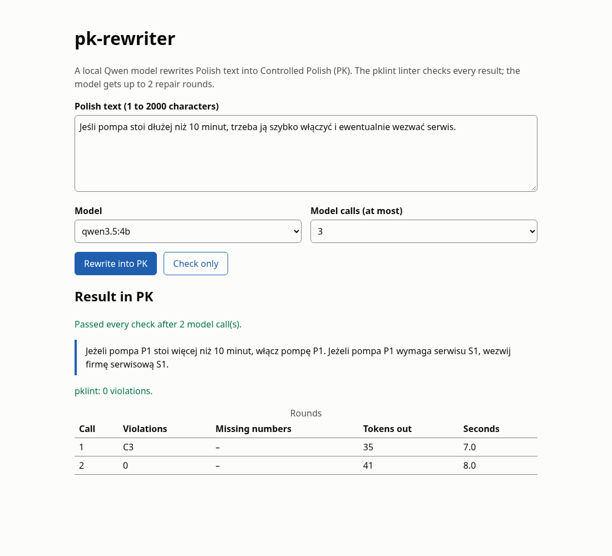
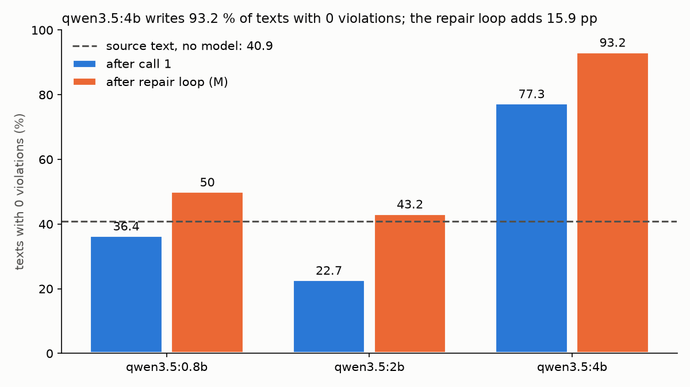

# pk-rewriter

Lokalny model Qwen3.5 przepisuje polski tekst na Polszczyznę Kontrolowaną (PK). Linter `pklint` sprawdza każdy wynik. Program uruchamia model na procesorze laptopa przez serwer Ollama. Wersja angielska: [README.md](README.md).

## Słownik

| Termin | Definicja | Słowa zakazane dla tego pojęcia |
|---|---|---|
| naruszenie | Trafienie lintera `pklint`, liczba z tekstu źródłowego, której brakuje w wyniku, albo pusty wynik. | błąd, usterka |
| runda | 1 wywołanie modelu i 1 sprawdzenie wyniku. | próba, iteracja |
| pętla | Ciąg rund dla 1 tekstu. Pętla kończy się po rundzie z 0 naruszeń albo po rundzie nr 3. | proces |
| miara M | Odsetek tekstów, które mają 0 naruszeń po pętli. | skuteczność |
| wzorzec | Tekst w PK, który autor zbioru testowego napisał dla tekstu źródłowego. | referencja, odpowiedź |
| chrF | Miara zgodności znaków między wynikiem a wzorcem w skali od 0 do 100 włącznie. | podobieństwo |
| znacznik | Napis `[DO USTALENIA: czego brakuje]`, który model wstawia w miejsce brakującego faktu. | luka |

## Cel

PK to polszczyzna z zestawem reguł. Każda reguła usuwa 1 źródło zdań, które mają więcej niż 1 znaczenie. Standard PK opisuje repozytorium [polszczyzna-kontrolowana](https://github.com/maciejszulia/polszczyzna-kontrolowana).

Projekt mierzy, jak model językowy na laptopie Lenovo ThinkPad T470p przepisuje tekst na PK. Linter `pklint` daje miarę jakości bez oceny człowieka. Program podaje modelowi każde naruszenie. Model poprawia tekst. Program wywołuje model co najwyżej 3 razy dla 1 tekstu.

## Zrzut ekranu

## Wyniki

| Model | Teksty | 0 naruszeń po pierwszym wywołaniu (%) | 0 naruszeń po pętli, M (%) | Średnia liczba rund | chrF po pierwszym wywołaniu | chrF po pętli | Sekundy na tekst | Tokeny na sekundę |
|---|---|---|---|---|---|---|---|---|
| tekst źródłowy bez modelu | 44 | 40,9 | – | – | 58,51 | – | – | – |
| qwen3.5:0.8b | 44 | 36,4 | 50,0 | 2,16 | 29,86 | 30,64 | 27,66 | 7,3 |
| qwen3.5:2b | 44 | 22,7 | 43,2 | 2,36 | 37,60 | 38,87 | 46,16 | 7,6 |
| qwen3.5:4b | 44 | 77,3 | 93,2 | 1,34 | 41,55 | 42,24 | 44,40 | 5,1 |

Skrypt `eval/run_eval.py` zapisał wyniki 2026-11-15 w pliku `eval/results/summary.json`. Sekcja „Maszyna” opisuje laptop, na którym biegł pomiar.

Zbiór testowy zawiera 44 teksty z pliku `data/items.csv` repozytorium PK, commit `e5c9248`. Każdy tekst ma 2 wzorce. Miara chrF używa wzorca, który daje wyższy wynik. Wiersz „tekst źródłowy bez modelu” podaje wynik tekstu przed przepisaniem. Pliki `eval/results/*.jsonl` zawierają odpowiedź modelu z każdej rundy.

Wnioski z pomiaru:

- Model qwen3.5:4b ma 0 naruszeń w 77,3 % tekstów po pierwszym wywołaniu. Po pętli model qwen3.5:4b ma 0 naruszeń w 93,2 % tekstów. Model qwen3.5:4b potrzebuje średnio 1,34 wywołania na tekst.
- Po pierwszym wywołaniu model qwen3.5:2b ma 0 naruszeń w 22,7 % tekstów. Model qwen3.5:0.8b ma 0 naruszeń w 36,4 % tekstów. Tekst źródłowy bez modelu ma 0 naruszeń w 40,9 % tekstów.
- Każdy model ma niższą wartość chrF niż tekst źródłowy bez zmian. Wzorce zachowują słowa tekstu źródłowego. Modele zmieniają nazwy obiektów, dodają zdania oraz pomijają treść.
- Linter `pklint` nie sprawdza znaczenia. Model qwen3.5:4b zmienił znaczenie w co najmniej 3 wynikach z 0 naruszeń:
  - Tekst „Jan powiedział Piotrowi, że jego pompa przecieka.” zmienił się w tekst „Pompa P1 nie przecieka. Jan powiadomił Piotra, aby sprawdził stan pompy P1.”. Wynik odwraca fakt.
  - Tekst „Regularnie sprawdzaj ciśnienie.” zmienił się w tekst „Sprawdzaj ciśnienie co najmniej raz dziennie.”. Wynik zgaduje częstość zamiast znacznika.
  - Tekst „Wymień filtr.” zmienił się w tekst „Wykonaj filtrowanie obiektu F1.”. Wynik nazywa inną czynność.
- Model qwen3.5:4b wstawił znacznik w 1 wyniku z 44. Zasada 1 standardu PK zakazuje zgadywania faktów. Linter nie wykrywa zgadywania.
- Model qwen3.5:0.8b przechodzi kontrolę lintera częściowo tekstem bez związku z tekstem źródłowym. Miara chrF modelu qwen3.5:0.8b wynosi 30,64 po pętli.

## Maszyna

Program Ollama w wersji 0.34.1 uruchomił każdy model na procesorze Intel Core i7-7700HQ. Karta GeForce 940MX nie wykonała obliczeń modelu. Plik [docs/hardware.md](docs/hardware.md) opisuje maszynę i dowody z logu serwera Ollama.

## Uruchomienie lokalne

Wykonaj każdy krok w tej kolejności:

1. Sklonuj repozytorium poleceniem `git clone https://github.com/maciejszulia/pk-rewriter`. Przejdź do katalogu `pk-rewriter`.
2. Zainstaluj program Ollama. Pobierz model poleceniem `ollama pull qwen3.5:4b`.
3. Utwórz środowisko Pythona w wersji 3.12 poleceniem `uv venv --python 3.12 .venv`.
4. Zainstaluj pakiet poleceniem `uv pip install -e ".[test,eval]"`.
5. Uruchom serwer poleceniem `.venv/bin/uvicorn pk_rewriter.api:app --port 8000`. Wynik: strona działa pod adresem `http://127.0.0.1:8000`.

Polecenie `.venv/bin/python -m unittest discover -s tests -v` uruchamia testy bez sieci. Atrapa zastępuje model w każdym teście. Polecenie `.venv/bin/python eval/run_eval.py qwen3.5:4b` uruchamia ewaluację modelu. Skrypt wznawia przerwany bieg z pliku wyników.

## Serwer MCP

Moduł `pk_rewriter/mcp_server.py` udostępnia klientom protokołu MCP 3 narzędzia: `pk_lint`, `pk_rewrite` oraz `pk_rule`. Narzędzie `pk_lint` zwraca naruszenia tekstu. Narzędzie `pk_rewrite` przepisuje tekst w pętli. Narzędzie `pk_rule` zwraca regułę PK dla kodu lintera. Klient uruchamia serwer poleceniem `.venv/bin/python -m pk_rewriter.mcp_server`. Tekst MUSI mieć od 1 do 2000 znaków włącznie.

## Uruchomienie w Dockerze

Wykonaj każdy krok w tej kolejności:

1. Uruchom kontenery poleceniem `docker compose up -d --build`.
2. Pobierz model poleceniem `docker compose exec ollama ollama pull qwen3.5:4b`.
3. Sprawdź serwer poleceniem `curl -s localhost:8000/health`. Wynik: odpowiedź zawiera `"ollama": true`.

Workflow `image.yml` publikuje obraz `ghcr.io/maciejszulia/pk-rewriter` dla każdego tagu `v*`. Plik `compose.yaml` publikuje port API tylko na adresie `127.0.0.1`, bo API nie ma uwierzytelniania.

## Sposób działania

1. Program wysyła prompt systemowy oraz tekst do serwera Ollama. Prompt systemowy ma 586 tokenów po polsku.
2. Prompt systemowy streszcza standard PK 0.1. Prompt zawiera 3 zasady PK, znacznik, reguły, format odpowiedzi oraz 2 przykłady autora projektu.
3. Linter `pklint` sprawdza odpowiedź modelu. Program sprawdza także liczby. Każda liczba z tekstu źródłowego MUSI wystąpić w odpowiedzi. Znacznik zwalnia odpowiedź z kontroli liczb.
4. Program wysyła modelowi każde naruszenie: kod lintera, opis naruszenia, zdanie oraz 1 zdanie reguły ze standardu PK.
5. Pętla kończy się po rundzie z 0 naruszeń albo po rundzie nr 3. Wynikiem jest runda z najmniejszą liczbą naruszeń.

Żadne zdanie ze zbioru testowego nie występuje w prompcie. Test jednostkowy pilnuje tego warunku.

## Granice metody

- Linter `pklint` sprawdza tylko reguły, które wyrażenie regularne rozstrzyga. Reguły A1, B2, B4 oraz B6 wymagają oceny człowieka. Test 2 znaczeń także wymaga oceny człowieka.
- Wynik z 0 naruszeń spełnia każdą regułę, którą linter sprawdza. Taki wynik nadal wymaga oceny człowieka.
- Linter pomija cytaty w cudzysłowie oraz kod. Tekst w cudzysłowie zostaje bez kontroli.
- Miara chrF porównuje znaki, a nie znaczenie. Odpowiedź ze znacznikiem spełnia zasadę 1 standardu PK, a miara chrF obniża wynik takiej odpowiedzi.
- Ewaluacja ma 44 teksty, 1 ziarno losowania oraz 1 bieg dla każdego modelu. Zmiana wyniku o 1 tekst zmienia odsetek o 2,3 punktu procentowego.
- Laptop uruchamiał inne programy w czasie ewaluacji. Plik [docs/hardware.md](docs/hardware.md) podaje obciążenie procesora.

## Licencja i autor

Licencja MIT, plik [LICENSE](LICENSE). Pliki `pk_rewriter/pklint.py` oraz `data/items.csv` pochodzą z repozytorium [polszczyzna-kontrolowana](https://github.com/maciejszulia/polszczyzna-kontrolowana), commit `e5c9248`. Oba repozytoria mają 1 autora: Maciej Szulia.
