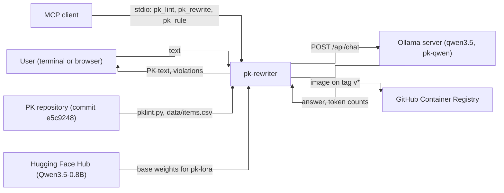
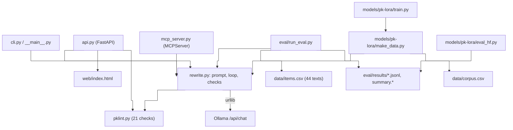
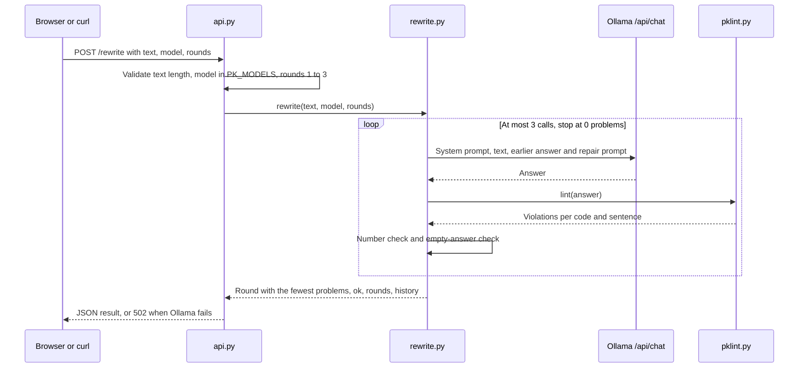

# pk-rewriter: architecture

This document describes the structure of pk-rewriter in the arc42 layout. pk-rewriter rewrites Polish text into Controlled Polish (PK) with a local Qwen3.5 model and checks every answer with the `pklint` linter.

## 1 Introduction and goals

pk-rewriter measures how well a small open model rewrites Polish text into PK on a laptop CPU, with an automatic check instead of a human impression. It offers the rewrite through a command line, an HTTP API with a web page, and an MCP server.

Quality goals:

1. **Objective check:** every answer passes through `pklint`, a number check and an empty-answer check ([ADR 0002](adr/0002-generate-check-repair-loop.md)).
2. **Local operation:** the model runs on the CPU through Ollama; no hosted model service is used ([ADR 0001](adr/0001-local-ollama-backend.md)).
3. **Reproducible measurement:** the evaluation resumes from its result files and writes a summary from them (`eval/run_eval.py`).

## 2 Constraints

| Constraint | Source |
|---|---|
| Python 3.12 or newer | `pyproject.toml` (`requires-python = ">=3.12"`) |
| Runtime dependencies: `fastapi`, `uvicorn` | `pyproject.toml` |
| Optional extras: `test` (`httpx`), `eval` (`matplotlib`), `mcp` (`mcp>=2.3`) | `pyproject.toml` |
| Model server: Ollama, `POST /api/chat` | `pk_rewriter/rewrite.py` |
| Input text: 1 to 2000 characters after whitespace strip | `MAX_CHARS = 2000` in `pk_rewriter/rewrite.py`; `Text` type in `api.py` and `mcp_server.py` |
| At most 3 model calls per text | `MAX_ROUNDS = 3` in `pk_rewriter/rewrite.py` |
| `pklint.py` is a verbatim copy from the PK repository, commit `e5c9248` | header of `pk_rewriter/pklint.py` |
| The HTTP API has no authentication | `README.md`, `compose.yaml` |
| License: MIT | `LICENSE`, `pyproject.toml` |

## 3 Context and scope

| Partner | Interface |
|---|---|
| Ollama | HTTP, `OLLAMA_URL` (default `http://127.0.0.1:11434`), endpoints `/api/chat` and `/api/version` |
| Browser | `GET /` serves `web/index.html`; the page calls `/health`, `/rewrite`, `/lint` |
| MCP client | stdio, command `python -m pk_rewriter.mcp_server` |
| Hugging Face Hub | `models/pk-lora/download_base.sh` downloads a pinned revision of Qwen3.5-0.8B |

## 4 Solution strategy

- **Generate, check, repair:** the model rewrites the text, `pklint` and the number check find violations, each violation goes back to the model with its rule; the best round wins ([ADR 0002](adr/0002-generate-check-repair-loop.md)).
- **One core, three front ends:** `rewrite.py` holds the loop; `cli.py`, `api.py` and `mcp_server.py` only validate input and format output.
- **Standard library for the model call:** `rewrite.chat` uses `urllib.request`, so the core needs no HTTP client package.
- **Vendored linter:** `pklint.py` is copied verbatim, so the rules match the PK standard version ([ADR 0003](adr/0003-vendored-pklint.md)).
- **Models built on top of the evaluation:** `pk-qwen` (Ollama `Modelfile`) and `pk-lora` (LoRA adapter through `transformers`) ([ADR 0005](adr/0005-lora-through-transformers.md)).

## 5 Building block view

| Building block | Path | Responsibility |
|---|---|---|
| Rewrite core | `pk_rewriter/rewrite.py` | System prompt, sampling options, `chat`, `check`, `repair_prompt`, `rewrite` |
| Linter | `pk_rewriter/pklint.py` | 21 regular-expression checks of PK rules (`CHECKS`), sentence splitting |
| Command line | `pk_rewriter/cli.py`, `pk_rewriter/__main__.py` | `python -m pk_rewriter [--model M] [--rounds N] [TEXT]`; exit code 0 when the result is clean, 1 otherwise, 2 on an Ollama error |
| HTTP API | `pk_rewriter/api.py` | `POST /rewrite`, `POST /lint`, `GET /health`, `GET /` |
| MCP server | `pk_rewriter/mcp_server.py` | Tools `pk_lint`, `pk_rewrite`, `pk_rule` over stdio |
| Web page | `web/index.html` | Form for rewrite and lint |
| Evaluation | `eval/run_eval.py` | Runs a model on 44 texts, resumable; chrF to 2 references; `--summary` writes `summary.json`, `summary.md`, `summary.png` |
| pk-qwen | `models/pk-qwen/Modelfile` | qwen3.5:4b with the PK prompt and sampling parameters built in |
| pk-lora | `models/pk-lora/` | Training data by rejection sampling (`make_data.py`), CPU training (`train.py`), evaluation through `transformers` (`eval_hf.py`) |
| Scripts | `scripts/machine.sh`, `scripts/pk_text.py` | Hardware table; plain prose of a Markdown file for `pklint` |
| Tests | `tests/` | 30 offline unit tests; a stand-in replaces the model |

## 6 Runtime view

### Rewrite through the HTTP API

1. `api.py` rejects an unknown model, an empty text or a text above 2000 characters before any model call.
2. `rewrite.rewrite` sends the system prompt and the text to Ollama with `stream: false`, `think: false` and the fixed options `temperature` 0.7, `top_p` 0.8, `top_k` 20, `seed` 42, `num_ctx` 4096, `num_predict` 1024.
3. `check` returns the `pklint` violations and the numbers of the source that the answer lacks; the marker `[DO USTALENIA` excuses missing numbers.
4. When a round has problems, the next call carries the base messages, the previous answer and a repair prompt that names each code, its description, the sentence and the rule.
5. The result is the round with the fewest problems (the earliest on a tie); `ok` is true when that round has none.

### Evaluation

`python eval/run_eval.py MODEL` reads `data/items.csv`, skips texts already in `eval/results/<model>.jsonl`, and appends one line per text. It pauses with exit code 3 when available memory falls below 2 GiB (`MIN_FREE_GIB`). `--summary` reads every result file and writes `summary.json`, `summary.md` and `summary.png`.

## 7 Deployment view

| Option | How | Source |
|---|---|---|
| Local | `uv venv`, `uv pip install -e ".[test,eval]"`, `uvicorn pk_rewriter.api:app --port 8000`, Ollama on the same machine | `README.md`, section "Run locally" |
| Docker Compose | Services `ollama` (image `ollama/ollama:0.34.1`, volume `ollama`) and `app` (`python:3.12-slim`, user `app` with uid 10001); the API port binds to `127.0.0.1` only ([ADR 0004](adr/0004-api-bound-to-localhost.md)) | `compose.yaml`, `Dockerfile` |
| Container image | Built and pushed to GHCR on every `v*` tag | `.github/workflows/image.yml` |
| MCP | `uv pip install -e ".[mcp]"`; the MCP client starts `.venv/bin/python -m pk_rewriter.mcp_server` | `README.md`, section "MCP server" |
| CI | On push and pull request: `pip install -e ".[test,mcp]"`, `python -m unittest discover -s tests -v` | `.github/workflows/ci.yml` |

Configuration: `OLLAMA_URL` (default `http://127.0.0.1:11434`, in the image `http://ollama:11434`) and `PK_MODELS` (default `qwen3.5:4b,qwen3.5:2b,qwen3.5:0.8b`; the first model is the API default).

## 8 Crosscutting concepts

- **Input validation at every boundary:** the same `Text` constraint (strip, 1 to 2000 characters) in `api.py` and `mcp_server.py`; the model must be in `PK_MODELS`; `rounds` from 1 to 3.
- **Error mapping:** an `OSError` from the Ollama call becomes HTTP 502 in the API, a `ToolError` in the MCP server and exit code 2 in the command line.
- **Offline tests:** `unittest.mock` replaces `rewrite.chat`; no test needs network or a model. `tests/test_rewrite.py` checks that no test text appears in any prompt.
- **Self-checks:** `pklint.py` has `selfcheck()`; `mcp_server.py --selftest` calls the 3 tools with a stand-in model.
- **Documentation gate:** `tests/test_docs.py` requires 0 `pklint` violations in the prose of `README.pl.md`.
- **Test set separation:** `make_data.py` drops every sentence of `data/items.csv` from the training data.

## 9 Architecture decisions

- [ADR 0001: Local Ollama backend on the CPU](adr/0001-local-ollama-backend.md)
- [ADR 0002: Generate, check, repair loop](adr/0002-generate-check-repair-loop.md)
- [ADR 0003: Vendored `pklint`](adr/0003-vendored-pklint.md)
- [ADR 0004: API bound to localhost, no authentication](adr/0004-api-bound-to-localhost.md)
- [ADR 0005: LoRA adapter through `transformers`, not Ollama](adr/0005-lora-through-transformers.md)

## 10 Quality requirements

| Quality | Scenario | Measure or evidence |
|---|---|---|
| Correctness of form | A rewrite with a detectable PK violation is not reported as `ok`. | `ok` requires 0 violations, 0 missing numbers and a non-empty answer (`rewrite.problems`). |
| Bounded cost | A text costs at most 3 model calls. | `MAX_ROUNDS = 3`; `tests/test_rewrite.py::test_at_most_3_calls`. |
| Testability | The test suite runs without network. | 30 test methods in `tests/`; CI installs no model. |
| Reproducibility | An interrupted evaluation resumes. | `eval/run_eval.py` skips texts already in the result file. |
| Security | The API is not reachable from other hosts by default. | `compose.yaml` binds `127.0.0.1:8000`. |

Measured results (2026-11-15, 44 texts, laptop CPU) are in `README.md`, section "Results", and `eval/results/summary.json`.

## 11 Risks and technical debt

- `pklint` decides only rules a regular expression can decide; 0 violations means "no detectable violation", not correct PK. The README shows answers with 0 violations that reverse a fact.
- The number check compares sets of digit strings; a marker excuses every missing number.
- 44 texts, 1 seed, 1 run per model: 1 text equals 2.3 percentage points, and there are no confidence intervals.
- The training dependencies of `pk-lora` (`torch`, `transformers`, `peft`, `accelerate`) are not declared in `pyproject.toml`; `models/pk-lora/README.md` lists the install commands.
- The trained adapter (`models/pk-lora/adapter/`) is in `.gitignore`, so the repository cannot reproduce the `pk-lora` results without a new training run.
- `pklint.py` is a copy; a fix in the PK repository does not reach this repository without a new copy.

### Open questions

- None.

## 12 Glossary

| Term | Meaning |
|---|---|
| PK | Polszczyzna Kontrolowana, Controlled Polish: Polish with rules that leave each sentence one meaning. |
| pklint | The linter of the mechanically decidable PK rules (`pk_rewriter/pklint.py`). |
| Violation | A `pklint` hit, a missing number of the source, or an empty answer. |
| Round | One model call and its check. |
| Marker | `[DO USTALENIA: …]`, the placeholder for a missing fact. |
| M | Share of texts with 0 violations after the loop. |
| chrF | Character n-gram F-score against the closer of 2 reference rewrites. |
| pk-qwen | Ollama model: qwen3.5:4b with the PK prompt built in. |
| pk-lora | LoRA adapter for Qwen3.5-0.8B trained on rewrites accepted by `pklint`. |
